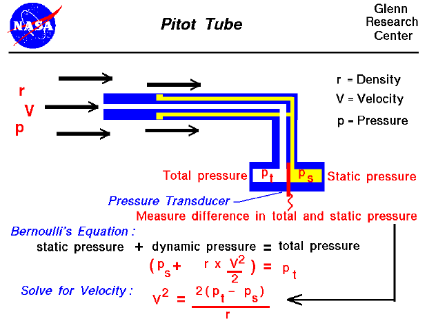
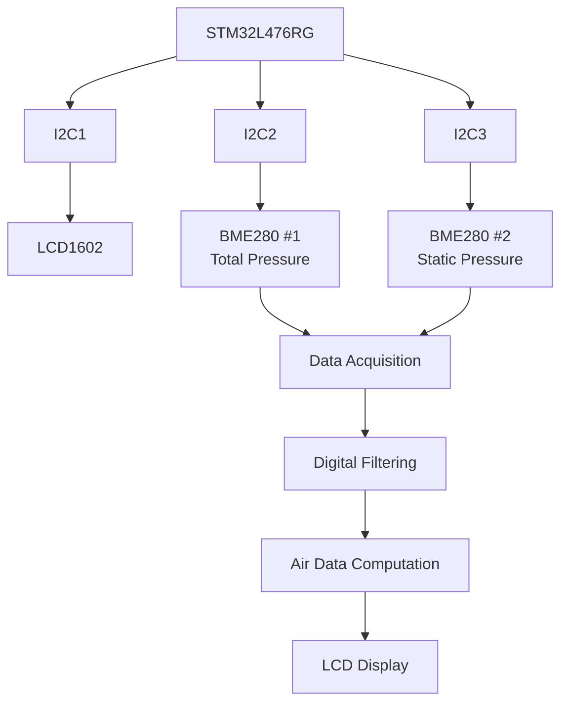

# ✈️ SMART PITOT
### Embedded Air Data Acquisition & Processing System

<p align="center">
  <strong>A custom STM32-based air data computer for experimental aerodynamic measurements.</strong>
</p>

<p align="center">
  
  
  
  
</p>

<p align="center">
  
</p>

---

## 🚀 Overview

**SMART PITOT** is an embedded air data acquisition and processing system designed for experimental aeronautical applications.

Originally developed using Arduino, the project is being migrated to the **STM32L476RG** microcontroller. The new implementation focuses on custom low-level peripheral drivers, modular software architecture and embedded signal processing.

The system uses two independent BME280 pressure sensors to acquire total and static pressure measurements. These measurements are processed to estimate aerodynamic and atmospheric parameters.

The objective is to develop a complete embedded measurement chain, from sensor acquisition to real-time air data visualization.

<p align="center">
  <em>From raw sensor measurements to meaningful air data.</em>
</p>

---

## 🧩 System Architecture



### Hardware configuration

| Component | Interface | Function |
|:---|:---:|:---|
| STM32L476RG | — | Main microcontroller |
| BME280 #1 | I2C2 | Total pressure acquisition |
| BME280 #2 | I2C3 | Static pressure acquisition |
| LCD1602 | I2C1 | Air data visualization |

The sensors operate on independent I2C buses, allowing both BME280 devices to use the same I2C address without an I2C multiplexer.

---

## ⚙️ Features & Objectives

| Feature | Description |
|:---|:---|
| Pressure acquisition | Independent total and static pressure measurements |
| Environmental sensing | Temperature and relative humidity acquisition |
| Digital filtering | Kalman-based sensor measurement filtering |
| Airspeed computation | IAS, CAS, EAS and TAS estimation |
| Atmospheric calculations | Air density and Mach number estimation |
| Altitude estimation | Barometric altitude calculation |
| Real-time visualization | Sequential air data display on LCD1602 |
| Custom peripheral drivers | Low-level I2C, BME280 and LCD1602 drivers |

---

## 🏗️ Software Architecture

The firmware follows a modular architecture, separating hardware drivers, data acquisition, signal processing and application-level calculations.

```text
SMART_PITOT/
│
├── Algorithms/
│   ├── Inc/
│   │   ├── atmosphere.h
│   │   └── kalman.h
│   └── Src/
│       ├── atmosphere.c
│       └── kalman.c
│
├── Application/
│   ├── Inc/
│   │   ├── acquisition.h
│   │   ├── air_data.h
│   │   ├── display.h
│   │   └── filtering.h
│   └── Src/
│       ├── acquisition.c
│       ├── air_data.c
│       ├── display.c
│       └── filtering.c
│
├── Core/
│   ├── Inc/
│   └── Src/
│       ├── main.c
│       ├── stm32l4xx_hal_msp.c
│       ├── stm32l4xx_it.c
│       └── system_stm32l4xx.c
│
├── Drivers/
│   ├── BME280/
│   │   ├── bme280.c
│   │   └── bme280.h
│   │
│   ├── I2C/
│   │   ├── i2c.c
│   │   └── i2c.h
│   │
│   ├── lcd1602_driver/
│   │   ├── lcd1602.c
│   │   └── lcd1602.h
│   │
│   ├── CMSIS/
│   └── STM32L4xx_HAL_Driver/
│
├── cmake/
│   └── arm-none-eabi-toolchain.cmake
│
├── CMakeLists.txt
├── CMakePresets.json
├── startup_stm32l476xx.s
├── STM32L476RGTx_FLASH.ld
└── README.md
```

### Processing pipeline

```text
             SENSOR DATA
                  │
                  ▼
           DATA ACQUISITION
                  │
                  ▼
           DIGITAL FILTERING
                  │
                  ▼
        ATMOSPHERIC CALCULATIONS
                  │
                  ▼
        AIR DATA COMPUTATION
                  │
          ┌───────┼───────┐
          ▼       ▼       ▼
         IAS     TAS    ALTITUDE
          │       │       │
          └───────┼───────┘
                  │
                  ▼
             LCD DISPLAY
```

---

## 📐 Air Data Parameters

The system aims to estimate the following parameters:

| Symbol | Parameter | Unit |
|:---:|:---|:---:|
| \(P_t\) | Total pressure | Pa |
| \(P_s\) | Static pressure | Pa |
| \(q_c\) | Impact pressure | Pa |
| IAS | Indicated Airspeed | m/s |
| CAS | Calibrated Airspeed | m/s |
| EAS | Equivalent Airspeed | m/s |
| TAS | True Airspeed | m/s |
| \(\rho\) | Air density | kg/m³ |
| \(M\) | Mach number | — |
| \(h\) | Barometric altitude | m |

The impact pressure is estimated from:

\[
q_c=P_t-P_s
\]

The airspeed and atmospheric parameters are derived from the measured pressures and the selected atmospheric model.

---

## 🛠️ Development Environment

| Tool / Technology | Purpose |
|:---|:---|
| Embedded C | Firmware development |
| STM32L476RG | Target microcontroller |
| STM32 HAL | MCU initialization and system services |
| CMSIS | Cortex-M and STM32 device definitions |
| CMake | Build system |
| Ninja | Build execution |
| ARM GNU Toolchain | ARM cross-compilation |
| Visual Studio Code | Development environment |
| ST-LINK | Hardware debugging and programming |
| STM32CubeProgrammer | Firmware flashing |

### Build Instructions

**Prerequisites**

- CMake
- Ninja
- ARM GNU Toolchain (`arm-none-eabi-gcc`)
- Git

**1. Clone the repository**

```bash
git clone <repository-url>
cd SMART_PITOT
```

**2. Configure the Debug build**

```bash
cmake --preset Debug
```

**3. Compile the firmware**

```bash
cmake --build --preset Debug
```

The build system generates the firmware in:

```text
build/Debug/
```

Expected output files:

- `SMART_PITOT.elf` — ELF firmware image
- `SMART_PITOT.hex` — Intel HEX firmware image
- `SMART_PITOT.bin` — Raw binary firmware image
- `SMART_PITOT.map` — Linker memory map

---

## 📍 Development Roadmap

### Hardware and Drivers
- [x] Custom I2C1, I2C2 and I2C3 drivers
- [x] BME280 driver
- [x] LCD1602 driver
- [ ] Hardware integration and peripheral validation
- [ ] Dual-sensor measurement characterization

### Data Processing
- [x] Data acquisition module
- [ ] Kalman filter integration and tuning
- [ ] Atmospheric model validation
- [ ] Air data computation validation
- [ ] IAS, CAS, EAS and TAS comparison against reference measurements

### Application
- [ ] LCD display integration and validation
- [ ] Experimental testing
- [ ] Measurement accuracy and repeatability assessment

---

## ⚠️ Experimental Limitations & Safety

SMART PITOT is an experimental engineering project intended for educational, development and laboratory applications.

The current design uses two independent **absolute-pressure BME280 sensors** to estimate impact pressure through the difference between total and static pressure measurements.

This approach has important limitations:

- Sensor-to-sensor offset can introduce significant errors in the calculated pressure difference.
- Sensor accuracy, resolution, noise, temperature dependence and calibration must be characterized.
- Digital filtering can reduce measurement noise but cannot eliminate systematic sensor bias.
- Airspeed accuracy depends on the complete measurement chain and the validity of the atmospheric and aerodynamic models.

**SMART PITOT is not a certified aviation instrument and must never be used as the sole source of flight-critical airspeed or altitude information.**

---

<p align="center">
  <strong>SMART PITOT</strong><br/>
  <sub>Embedded Systems · Aeronautics · Sensor Fusion · Air Data</sub>
</p>